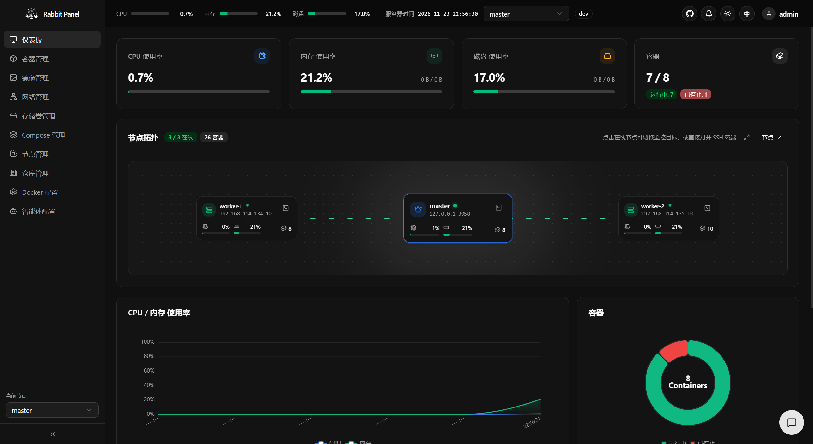
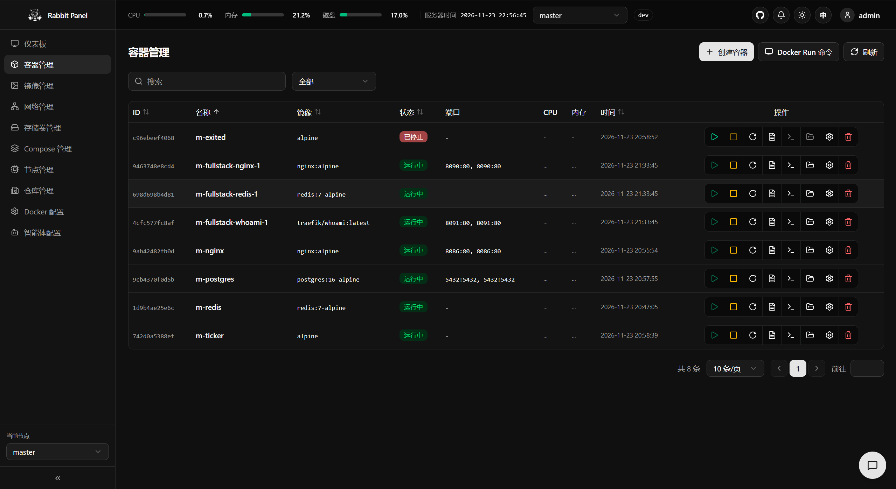
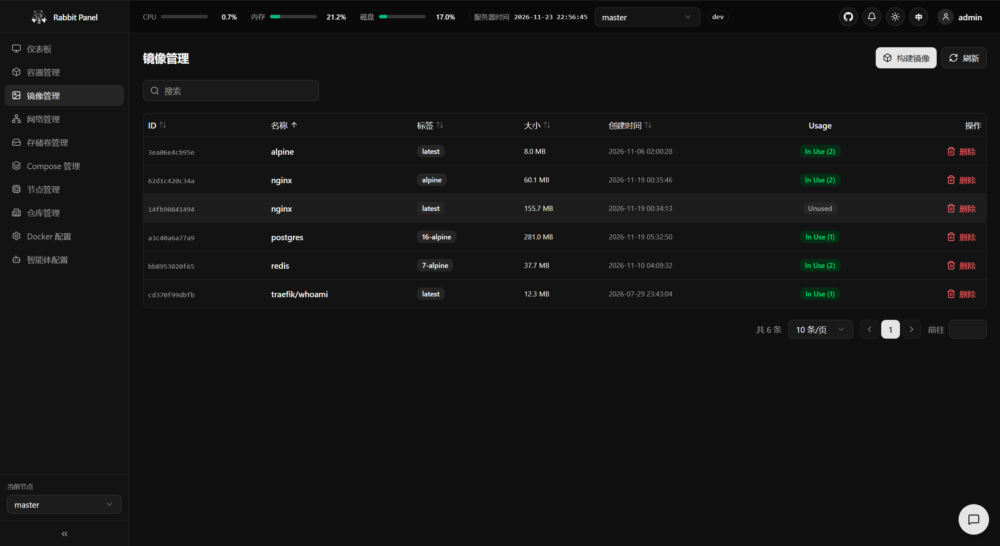
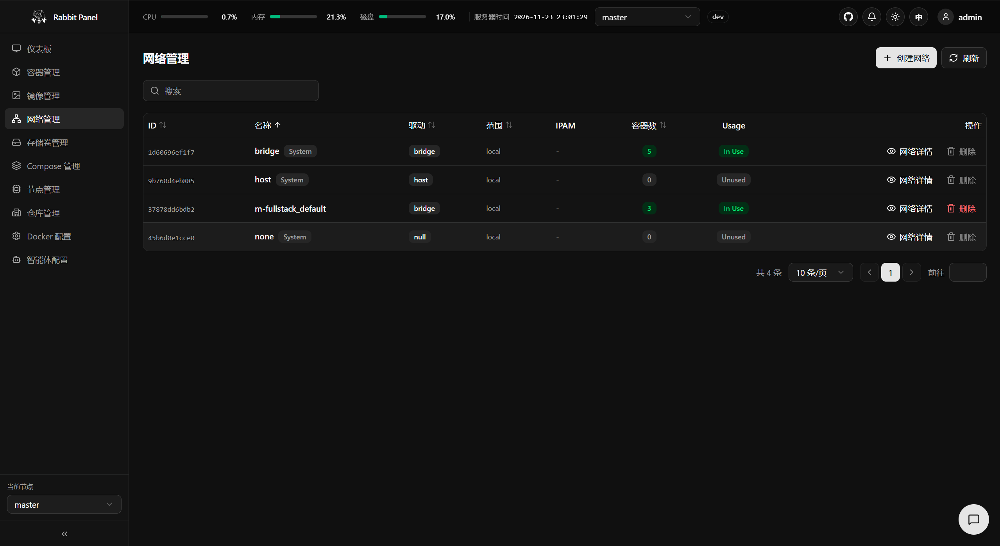
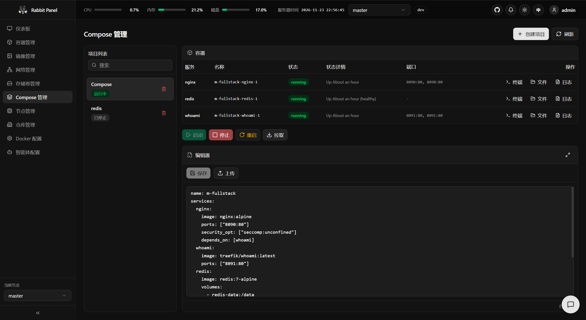
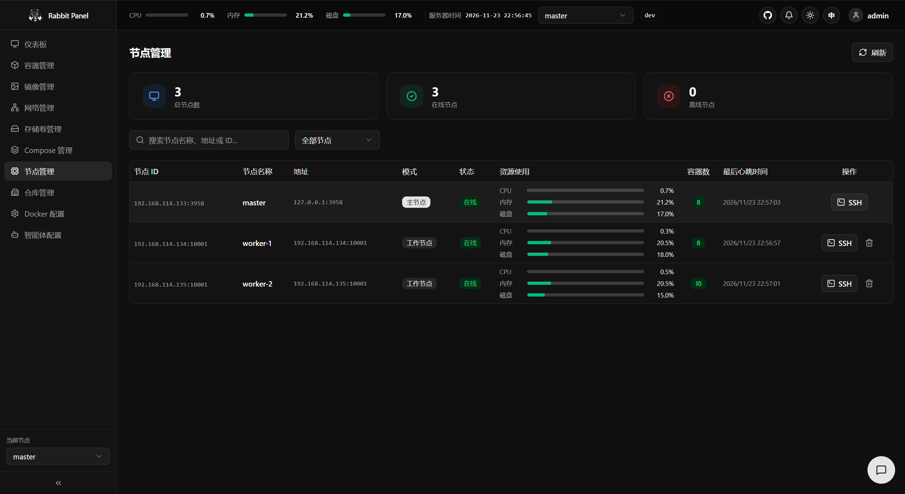
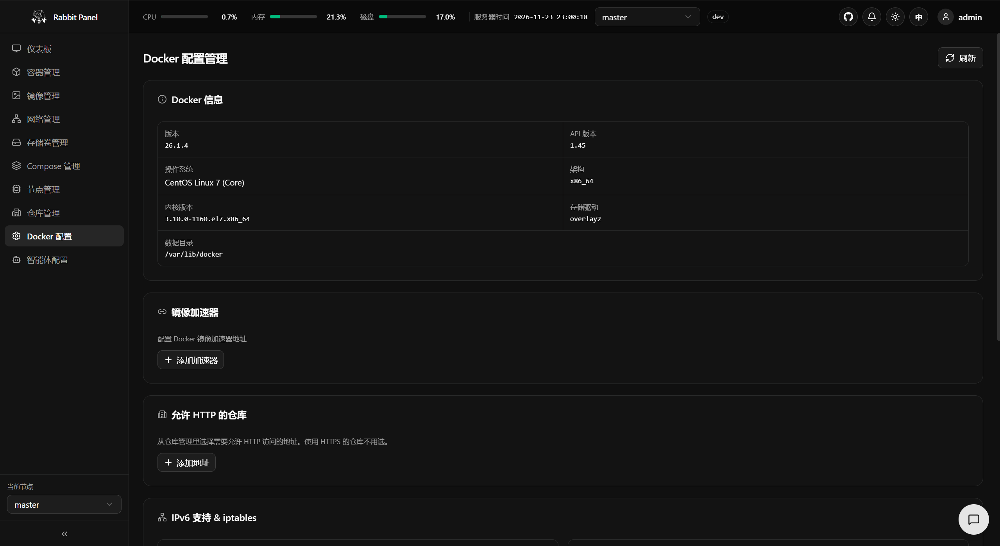
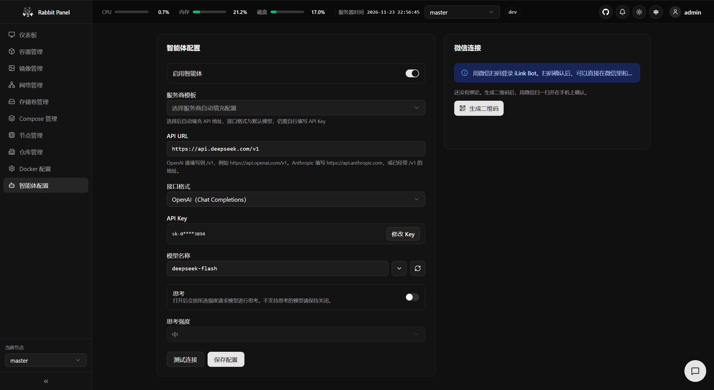
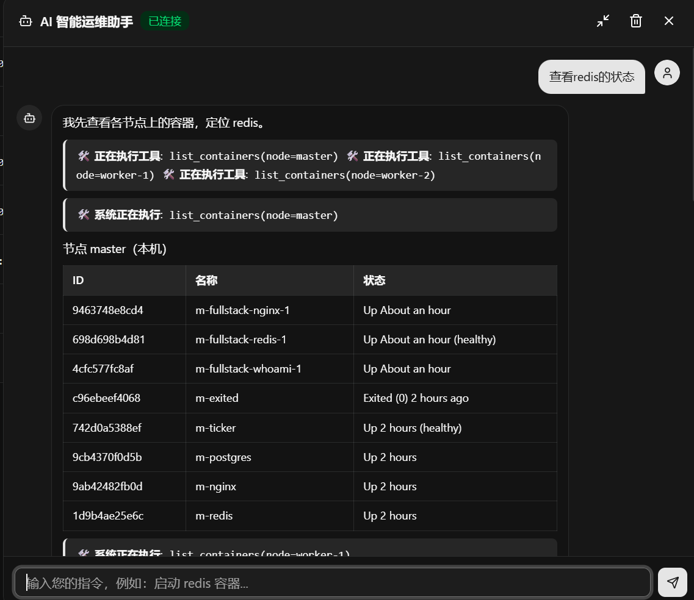

<div align="center">

# Rabbit Panel

**极致轻量的 AI 智能容器运维面板**

[](https://github.com/reisen7/rabbit-panel/releases)
[](https://hub.docker.com/r/reisen7/rabbit-panel)
[](backend/go.mod)
[](#快速开始)
[](LICENSE)

</div>

单二进制部署、前端内嵌、SQLite 本地存储的 Docker 运维面板，支持多节点管理、AI 助手与面板内在线更新。默认端口 `3958`，默认 **HTTP**，设置 `TLS_ENABLED=true` 即可启用 HTTPS。

## 目录

- [Rabbit Panel](#rabbit-panel)
  - [目录](#目录)
  - [特性](#特性)
  - [界面预览](#界面预览)
  - [快速开始](#快速开始)
    - [Docker（推荐）](#docker推荐)
    - [Docker Compose](#docker-compose)
    - [一键脚本（systemd）](#一键脚本systemd)
  - [多节点部署](#多节点部署)
  - [二进制启动示例](#二进制启动示例)
  - [环境变量](#环境变量)
  - [HTTPS](#https)
  - [从源码构建](#从源码构建)
  - [常见问题](#常见问题)
  - [更新日志](#更新日志)
  - [许可证](#许可证)

## 特性

- **轻量自包含**：单二进制、前端内嵌、SQLite 本地存储，无需外部数据库
- **Docker 全栈管理**：容器 / 镜像 / 网络 / 存储卷 / Compose 项目，镜像仓库认证与 daemon 配置管理
- **运维直达容器**：Web 终端、实时日志查看、容器文件浏览器与在线编辑
- **监控与告警**：系统资源仪表盘，容器异常可绑定 Showdoc Token 按规则推送微信
- **多节点管理**：Master / Worker 架构，一个面板统一管理多台主机；仪表盘节点拓扑实时展示各节点状态与容器数，容器 / 镜像 / 网络 / 存储卷 / Compose 均可按节点切换；节点列表与拓扑一键打开 Web SSH 终端或 SFTP 文件管理
- **AI 助手**：内置 OpenAI / Anthropic / Gemini / Grok / DeepSeek / GLM 服务商模板一键填充，支持多种模型接口与工具调用，可扫码连接微信远程运维
- **安全**：登录验证码、首次登录强制改密、原生 HTTPS
- **体验**：亮 / 暗主题、中英双语界面、面板内一键在线更新

## 界面预览

|                首页                 |               容器管理                |                镜像管理                |
| :---------------------------------: | :-----------------------------------: | :------------------------------------: |
|  |  |  |

|               网络管理               |             Compose 管理              |               节点管理                |
| :----------------------------------: | :-----------------------------------: | :-----------------------------------: |
|  |  |  |

|              Docker 配置              |              智能体配置              |              AI 智能助手              |
| :----------------------------------: | :-----------------------------------: | :-----------------------------------: |
|  |  |  |

## 快速开始

> [!IMPORTANT]
> 默认账号：`admin`　默认密码：`admin`
> **首次登录强制修改密码**，请部署后立即设置高强度密码

### Docker（推荐）

```bash
docker run -d \
  --name rabbit-panel \
  --restart unless-stopped \
  -p 3958:3958 \
  -v /var/run/docker.sock:/var/run/docker.sock \
  -v /opt/rabbit-panel/compose_projects:/app/compose_projects \
  -v /opt/rabbit-panel/data:/app/data \
  -e TZ=Asia/Shanghai \
  reisen7/rabbit-panel:latest
```

### Docker Compose

```bash
git clone https://github.com/reisen7/rabbit-panel.git
cd rabbit-panel
docker compose -f docker-compose.deploy.yml up -d
```

### 一键脚本（systemd）

```bash
curl -fsSL https://raw.githubusercontent.com/reisen7/rabbit-panel/main/install.sh | bash
```

## 多节点部署

```bash
docker compose -f docker-compose.master.yml up -d   # Master
docker compose -f docker-compose.worker.yml up -d   # Worker
```

> [!IMPORTANT]
> - Worker 的 `JWT_SECRET`、`NODE_SECRET` 必须与 Master一致，Master 与 Worker 的系统时间差不能超过 1 小时。
> - Worker 的 `MASTER_URL` 写 `http://master-ip:3958`；Master 启用了 HTTPS 时改为 `https://`（未写协议时按 Worker 自身 TLS 状态推断）。
> - `NODE_ADDRESS` 写 `IP:端口` 即可，Worker 会自动补协议前缀。
> - 自签证书场景需设 `NODE_TLS_INSECURE=true`，或用 `NODE_CA_FILE` 分发 CA，否则跨节点调用会因证书校验失败。

## 二进制启动示例

面板全部配置通过环境变量读取，变量含义查「环境变量」一节表格。

> [!IMPORTANT]
> **配置文件唯一约定位置：`./data/secrets.env`**（数据目录下，每行一个 `KEY=VALUE`，支持 `#` 注释）。二进制启动时**自动读取该文件**——不需要 `source`、不需要 systemd `EnvironmentFile`。优先级：显式环境变量（`docker -e`、shell export）> 文件。程序自动生成的密钥也追加存放在同一文件（不会覆盖你的配置）。路径跟随启动时的工作目录，请固定在同一个目录下启动。

**直接运行（Linux / macOS）**

```bash
# 最简启动：什么都不用配
./rabbit-panel-linux-amd64
```

首次启动自动生成 `JWT_SECRET` / `NODE_SECRET` 写入 `./data/secrets.env`（0600 仅属主可读），重启密钥不变。查看：

```bash
cat ./data/secrets.env    # 配 Worker 时取这里面的值
```

需要自定义配置时往同一个文件里写（不存在就自己建），重启生效：

```bash
mkdir -p data
cat >> data/secrets.env <<'EOF'
TLS_ENABLED=true
PORT=3958
EOF
./rabbit-panel-linux-amd64
```

**一键脚本部署（systemd）**

配置写进 `./data/secrets.env` 后 `systemctl restart rabbit-panel` 即生效——程序启动时自己读文件，无需在 unit 里配 `EnvironmentFile`。

**Windows**

与 Linux 完全一致：配置写在 exe 同级 `data\secrets.env`（用记事本编辑即可），然后直接运行 exe。

**Worker 节点示例**

在 Worker 机器上把配置写进数据目录，然后直接启动：

```bash
mkdir -p data
cat > data/secrets.env <<'EOF'
MODE=worker
MASTER_URL=http://x.x.x.x:3958
JWT_SECRET=与Master完全相同的值
NODE_SECRET=与Master完全相同的值
NODE_NAME=worker-1
PORT=10001
EOF

./rabbit-panel-linux-amd64
```

密钥从 Master 上抄：`cat ./data/secrets.env`（Docker 部署时在宿主机挂载的数据目录里，如 `/opt/rabbit-panel/data/secrets.env`）。注意**完整复制，漏一个字符都会导致认证失败**。

- `MASTER_URL` 是 Master 的地址；`NODE_ADDRESS` 是本 Worker 的地址（`IP:端口`，Worker 会自动补协议前缀），要填 Master 能访问到的地址；二进制直接部署时可留空自动探测，Docker 部署必须显式填宿主机 IP
- `JWT_SECRET`、`NODE_SECRET` 必须与 Master 完全一致且至少 32 字符，Worker 不设会拒绝启动
- Master 是自签 HTTPS 时加 `NODE_TLS_INSECURE=true`
- Docker 部署时用 `-e` 传参或写进挂载数据目录的 `secrets.env` 均可，`-e` 优先

## 环境变量

| 变量 | 说明 |
| --- | --- |
| `MODE` | `master`（默认）或 `worker` |
| `HOST` / `PORT` | 监听地址与端口，默认 `0.0.0.0` / `3958` |
| `DOCKER_HOST` | Docker 守护进程地址，未设置时沿用 Docker CLI 当前 context（默认本机 socket） |
| `JWT_SECRET` | 登录令牌密钥。Master / 单机可不设：**首次启动自动生成并保存到 `./data/secrets.env`（0600 权限），之后每次启动从文件读回**——重启不掉登录态、密钥固定。设置时至少 32 个字符且不能是示例值，可用 `openssl rand -hex 32` 生成。Worker 必填 |
| `NODE_SECRET` | 节点通信密钥，规则同 `JWT_SECRET`。Worker 必填，且与 Master 一致；Master 端未设置时同样自动持久化，配置 Worker 前用 `cat ./data/secrets.env` 查看即可 |
| `MASTER_URL` | Worker 连接的 Master 面板地址，如 `http://x.x.x.x:3958`；Master 启用 HTTPS 时写 `https://x.x.x.x:3958` |
| `NODE_NAME` / `NODE_ADDRESS` | Worker 显示名称（如 `worker-1`）/ Master 能访问到的 Worker 地址（如 `x.x.x.x:10001`）。`NODE_ADDRESS` 可留空，此时自动探测通往 Master 的本机出口 IP；**Docker 部署必须显式设置**否则探到的是容器 IP，Master 无法回连 |
| `RABBIT_UPDATE_CHECK_DISABLED` | 设为 `true` 跳过更新检查，界面不显示更新提示 |
| `RABBIT_UPDATE_MANIFEST_MIRROR_URL` | 更新清单镜像源，默认 jsDelivr，设为 `off` 禁用。jsDelivr 对分支内容最长缓存约 12 小时，新版本提示可能延迟 |
| `RABBIT_UPDATE_DOWNLOAD_PROXY` | 可选，GitHub 下载加速前缀（如 `https://ghfast.top/`），仅对 github.com 下载地址生效。二进制仍会校验 sha256，缺少 sha256 的清单会拒绝更新 |

## HTTPS

面板默认以 HTTP 启动。设置 `TLS_ENABLED=true` 启用 HTTPS；未提供证书时（`TLS_SELF_SIGNED` 默认 `true`），首次启动会在 `./data/certs/` 生成一张 10 年有效的自签证书（浏览器提示不受信任属正常现象）。

| 变量 | 默认值 | 说明 |
| --- | --- | --- |
| `TLS_ENABLED` | `false` | 设为 `true` 启用 HTTPS |
| `TLS_CERT_FILE` | `./data/certs/server.crt` | 证书路径（PEM，可含证书链） |
| `TLS_KEY_FILE` | `./data/certs/server.key` | 私钥路径（PEM） |
| `TLS_SELF_SIGNED` | `true` | 证书缺失 / 过期 / `TLS_HOSTS` 变化时自动生成自签证书 |
| `TLS_HOSTS` | 空 | 自签证书需覆盖的额外域名或 IP，逗号分隔（默认已含 `localhost`、`127.0.0.1`、`::1`、主机名与本机网卡 IP） |
| `HTTP_PORT` | 空 | 额外监听该端口，把 HTTP 301 跳转到 HTTPS（`/api/health` 直接返回 `OK`） |
| `TLS_REDIRECT_PORT` | 同 `PORT` | 跳转目标使用的**对外** HTTPS 端口，`-p 8443:3958` 这类映射必须设置 |
| `NODE_TLS_INSECURE` | `false` | 访问其它节点时跳过证书校验（自签场景） |
| `NODE_CA_FILE` | 空 | 访问其它节点时额外信任的 CA 证书路径 |

**自签证书**：证书随数据卷持久化，重启不会重新生成，修改 `TLS_HOSTS` 后自动重签。

```bash
-e TLS_ENABLED=true \
-e TLS_HOSTS=panel.example.com,x.x.x.x \
-e HTTP_PORT=3959
```

**已有证书**：关闭自签，挂载证书目录并指向具体文件。

```bash
-v /etc/letsencrypt:/etc/letsencrypt:ro \
-e TLS_ENABLED=true \
-e TLS_SELF_SIGNED=false \
-e TLS_CERT_FILE=/etc/letsencrypt/live/panel.example.com/fullchain.pem \
-e TLS_KEY_FILE=/etc/letsencrypt/live/panel.example.com/privkey.pem
```

- 要挂载整个 `/etc/letsencrypt`：`live/` 下都是指向 `archive/` 的软链接，只挂 `live/xxx` 会断链，启动报「加载 TLS 证书失败」。也不要把外部证书放进 `/app/data/certs`（自签目录）。
- 证书只在启动时读取，续期后需重启：`certbot renew --deploy-hook "docker restart rabbit-panel"`。
- 前面已有 Nginx / Cloudflare 做 TLS 终止时，保持默认 HTTP 即可。反代带 `X-Forwarded-Proto: https` 时，登录 Cookie 仍会自动加 `Secure`。
- 服务端固定 HTTP/1.1，因为容器终端依赖 WebSocket 升级，当前实现不支持 HTTP/2；页面为 HTTPS 时，前端终端自动使用 `wss://`。
- 自签证书只防明文传输，不防中间人，生产环境建议换受信任证书。自签证书旁的 `server.crt.hosts` 记录了证书指纹和域名 / IP；直接覆盖 `server.crt` 后指纹对不上，面板会当作用户证书而不覆盖。想恢复自签，删掉 `./data/certs/` 后重启。

## 从源码构建

要求：Go 1.25+、Node.js ≥ 20.19（Vite 7）、npm 或 pnpm。

```bash
git clone https://github.com/reisen7/rabbit-panel.git
cd rabbit-panel

./rabbit.sh build                  # 前端 + 后端，当前主机架构（Windows 用 rabbit.bat）
./rabbit.sh build all              # 交叉编译全部支持平台
./rabbit.sh build --skip-frontend  # 跳过前端，复用已有 backend/.dist
```

前端产物输出到 `backend/.dist/`，通过 `go:embed` 内嵌进二进制，最终交付为单个可执行文件。

本地开发：

```bash
# 后端：默认监听 0.0.0.0:3958（HTTP），TLS_ENABLED=true 启用自签 HTTPS
cd backend && go run main.go

# 前端：默认 :3000，代理 API / WebSocket 到 :3958
# 后端启用 HTTPS 时：RABBIT_DEV_BACKEND=https://localhost:3958 npm run dev
cd frontend && npm install && npm run dev
```

测试：

```bash
cd frontend && npm run test     # 前端测试（Vitest）
cd backend && go test ./...     # 后端测试
```

技术栈：Go 1.25 + Gin + modernc/sqlite + Docker API ｜ Vue 3 + TypeScript + Vite + Tailwind CSS 4 + shadcn-vue（Reka UI）+ Pinia + ECharts + xterm.js。

## 常见问题

**忘记管理员密码？**
停止面板，删除数据目录下的 `auth.db`（Docker 部署位于挂载的 `data` 卷内），重启后自动重建 `admin / admin`。该操作会清空所有用户与登录会话。

**二进制部署报 docker.sock 权限错误？**
确保运行用户可访问 `/var/run/docker.sock`（将用户加入 `docker` 组），或设置 `DOCKER_HOST` 指向可访问的 Docker 守护进程。

**更新提示一直没出现？**
检查 `RABBIT_UPDATE_CHECK_DISABLED` 是否被设为 `true`；默认更新清单经 jsDelivr 分发，分支内容最长缓存约 12 小时，新版本提示可能有延迟。

## 更新日志

见 [.doc/CHANGELOG.md](.doc/CHANGELOG.md)。

## 许可证

[MIT License](LICENSE)
