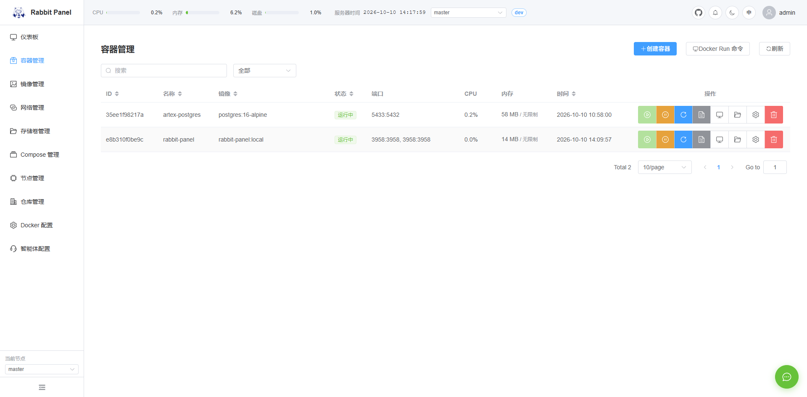
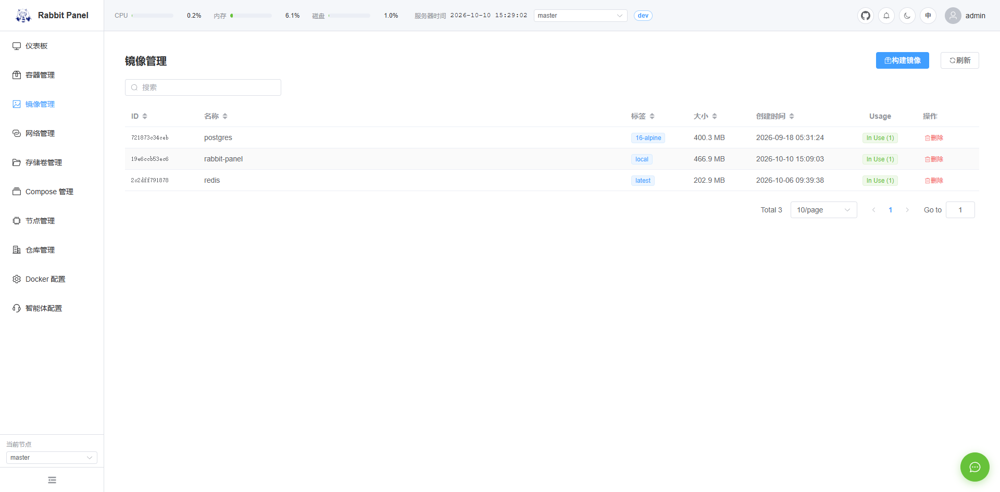
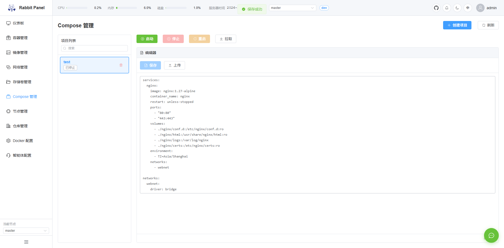
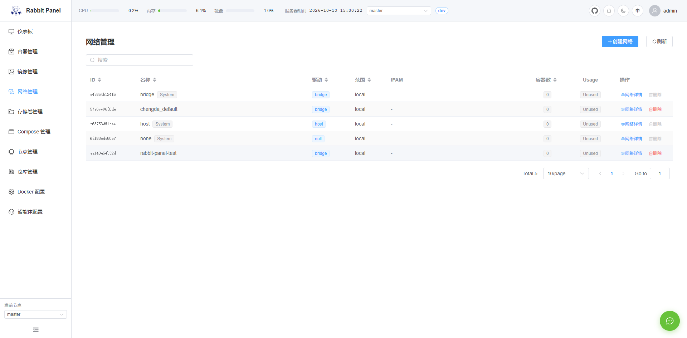
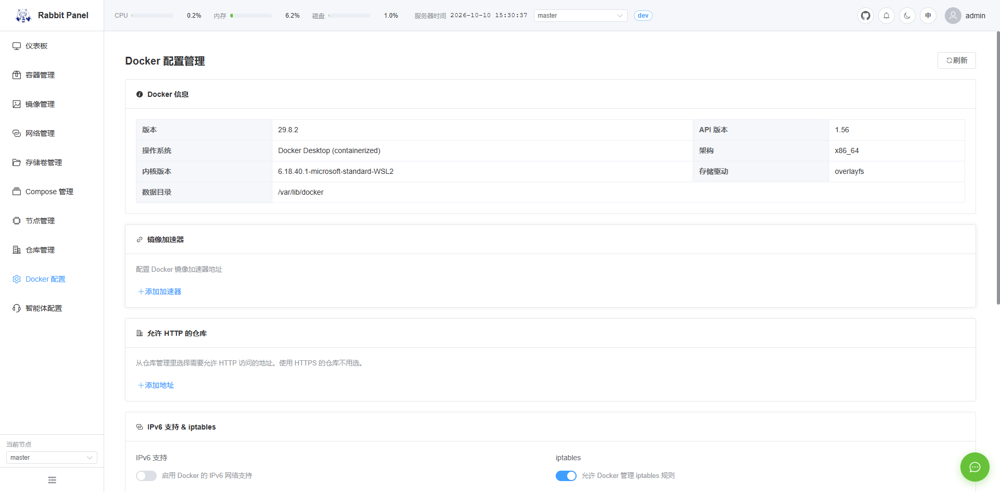

# Rabbit Panel ｜ 极致轻量 AI 智能容器运维面板

一个面向 Linux 服务器的轻量 Docker 运维面板，支持 ARM64 / armv7 / x86_64、多节点管理、AI 助手与在线更新。默认端口 `3958`，默认以 **HTTPS** 提供服务（首次启动自动生成自签证书）。

## 特性

- 轻量：单二进制、内置前端、SQLite 本地存储
- 容器 / 镜像 / 网络 / 存储卷 / Compose 管理
- Docker 配置、仓库配置、系统监控
- 多节点 Master / Worker 管理
- 默认 HTTPS：原生 TLS，首次启动自动生成自签证书，可选 HTTP 跳转端口
- AI 助手支持多种模型接口，并可扫码连接微信
- 智能体可以操作已登记的其他节点
- 在线更新、版本检测、进度反馈
- 中文 / English 界面

|                     首页                      |                    容器管理                     |
| :-------------------------------------------: | :---------------------------------------------: |
|  |  |

|                    镜像管理                     |                  Compose 管理                   |
| :---------------------------------------------: | :---------------------------------------------: |
|  |  |

|                    网络管理                     |                    配置管理                     |
| :---------------------------------------------: | :---------------------------------------------: |
|  |  |

|                      LLM 1                      |                      LLM 2                      |
| :---------------------------------------------: | :---------------------------------------------: |
|  |  |

## 环境要求

- Linux
- Docker 20.10+
- 4GB+ RAM

## 快速开始

### Docker

```bash
docker run -d \
  --name rabbit-panel \
  --restart unless-stopped \
  -p 3958:3958 \
  -v /var/run/docker.sock:/var/run/docker.sock \
  -v /root/rabbit-panel/compose_projects:/app/compose_projects \
  -v /root/rabbit-panel/data:/app/data \
  -e TZ=Asia/Shanghai \
  reisen7/rabbit-panel:latest
```

或：

```bash
git clone https://github.com/reisen7/rabbit-panel.git
cd rabbit-panel
docker compose -f docker-compose.deploy.yml up -d
```

### 一键安装二进制（systemd）

```bash
curl -fsSL https://raw.githubusercontent.com/reisen7/rabbit-panel/main/install.sh | bash
```

> 如果你希望使用面板内“立即更新”，二进制部署必须通过 `systemd` 管理。

## 多节点

Master：

```bash
docker compose -f docker-compose.master.yml up -d
```

Worker：

```bash
docker compose -f docker-compose.worker.yml up -d
```

> `JWT_SECRET` 和 `NODE_SECRET` 必须一致。  
> Master / Worker 系统时间差不能超过 1 小时。

## 配置

关键环境变量：

- `MODE=master|worker`
- `HOST=0.0.0.0`
- `PORT=3958`
- `JWT_SECRET=...`
- `NODE_SECRET=...`
- `NODE_NAME=worker-1` Worker 显示名称；Master 不填时显示为 `master`
- `NODE_ADDRESS=192.168.1.20:10001` Master 能访问到的 Worker 地址
- `RABBIT_UPDATE_CHECK_DISABLED=true` 跳过更新检查（不再请求 `MANIFEST_URL`，界面不显示更新提示）

默认账户：

- `admin / admin`

首次登录后必须修改密码。

## 原生 HTTPS

面板**默认以 HTTPS 启动**，无需反向代理。首次启动找不到证书时，会自动在 `./data/certs/` 生成一张 10 年有效的自签证书，开箱即可用 `https://` 访问（浏览器提示证书不受信任属正常现象）。

| 变量 | 默认值 | 说明 |
| --- | --- | --- |
| `TLS_ENABLED` | `true` | 设为 `false` 退回纯 HTTP |
| `TLS_CERT_FILE` | `./data/certs/server.crt` | 证书路径（PEM，可含证书链） |
| `TLS_KEY_FILE` | `./data/certs/server.key` | 私钥路径（PEM） |
| `TLS_SELF_SIGNED` | `true` | 证书缺失/过期/`TLS_HOSTS` 变化时自动生成自签证书 |
| `TLS_HOSTS` | 空 | 自签证书需覆盖的额外域名或 IP，逗号分隔（默认已含 `localhost`、`127.0.0.1`、`::1`、主机名与本机网卡 IP） |
| `HTTP_PORT` | 空 | 额外监听该端口，把 HTTP 301 跳转到 HTTPS（`/api/health` 直接返回 `OK`） |
| `TLS_REDIRECT_PORT` | 同 `PORT` | 跳转目标使用的**对外** HTTPS 端口，`-p 8443:3958` 这类映射必须设置 |
| `NODE_TLS_INSECURE` | `false` | 访问其它节点时跳过证书校验（自签场景） |
| `NODE_CA_FILE` | 空 | 访问其它节点时额外信任的 CA 证书路径 |

### 使用自签证书（默认）

按「快速开始」启动即可。要指定域名/IP 并开一个 HTTP 跳转端口：

```bash
-e TLS_HOSTS=panel.example.com,192.168.1.10 \
-e HTTP_PORT=3959
```

证书随数据卷持久化，重启不重新生成；改 `TLS_HOSTS` 后会自动重签。

### 使用已有证书

关掉自签，挂载证书目录并指向具体文件：

```bash
-v /etc/letsencrypt:/etc/letsencrypt:ro \
-e TLS_SELF_SIGNED=false \
-e TLS_CERT_FILE=/etc/letsencrypt/live/panel.example.com/fullchain.pem \
-e TLS_KEY_FILE=/etc/letsencrypt/live/panel.example.com/privkey.pem
```

> 要挂载整个 `/etc/letsencrypt`：`live/` 下都是指向 `archive/` 的软链接，只挂 `live/xxx` 会断链导致启动报「加载 TLS 证书失败」。也不要把外部证书放进 `/app/data/certs`（自签目录）。

证书只在启动时读取，续期后需重启：`certbot renew --deploy-hook "docker restart rabbit-panel"`。

### 多节点

- Worker 的 `MASTER_URL` 写 `https://master-ip:3958`（未写协议时按自身 TLS 状态推断）。
- `NODE_ADDRESS` 保持 `IP:端口` 即可，Worker 会自动补协议前缀。
- 自签场景需设 `NODE_TLS_INSECURE=true`，或通过 `NODE_CA_FILE` 分发 CA，否则跨节点调用会因证书校验失败。

### 关闭 HTTPS

前面已有 Nginx / Cloudflare 做 TLS 终止时，设 `TLS_ENABLED=false` 即可。反代转发带 `X-Forwarded-Proto: https` 时，登录 Cookie 仍会自动加 `Secure`。

### 说明

- 服务端固定 **HTTP/1.1**（ALPN 只协商 `http/1.1`），因为容器终端依赖 WebSocket 升级，当前 WebSocket 实现不支持 HTTP/2。
- 页面为 HTTPS 时，前端容器终端自动使用 `wss://`。
- 自签证书只消除明文传输，不防中间人；生产环境建议换受信任证书。
- 自签证书旁有 `server.crt.hosts` 标记文件（记录证书指纹与域名/IP 列表）。若你直接覆盖 `server.crt`，指纹对不上，面板会当作用户证书而不覆盖它；想恢复自签，删掉 `./data/certs/` 重启。

## 更新日志

查看完整更新日志：[.doc/CHANGELOG.md](.doc/CHANGELOG.md)

## 许可证

MIT License
